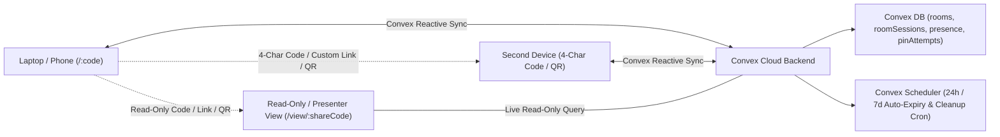

# Notefy — Product & Technical Specification

> **Instant, zero-login online notepad synced in real time across devices—shareable anywhere with a 4-character access code, custom link, or QR code.**

---

## 1. The Problem

Moving notes, outlines, links, code snippets, or checklists between your phone and laptop—or sharing live notes with a teammate or classroom—usually forces clunky workarounds:

1. **Texting yourself** in chat apps buries important notes in endless scroll and lacks rich formatting.
2. **Account friction** makes opening personal apps on a work, school, or borrowed computer annoying and risky.
3. **Hard to share cleanly**—there's no effortless way to hand someone a 4-character code, custom URL, or giant projector QR code that updates live as you write.

---

## 2. Product Concept

**Notefy** pairs a calm, full-width rich-text notepad with frictionless cross-device syncing and sharing powered by **Convex**:

- **Zero-login start:** Click **Start Writing** on `/` to open a live notepad immediately with a unique **4-character alphanumeric code** (e.g., `K7M4`).
- **Access via 4-character code, custom link, or QR:** Enter the 4-character code into the tactile 4-slot input on `/` (or the sidebar), open its direct URL (`/:code`), or scan its QR code to sync live across devices.
- **Two access modes:**
  - **Edit & Sync (`/:code`):** Full two-way real-time editing via 4-character code, custom link, or QR code.
  - **Read-Only Showcase (`/view/:shareCode`):** Clutter-free live view (no sidebar or editing toolbar) with a dedicated 4-character view code, custom view slug, QR code, and **Big-Screen Presenter Mode** (`P`).
- **Privacy & Lifecycle Controls:** Optional server-hashed **PIN Lock** (*Lock edits only* or *Lock entire note*), optional **Auto-Expiry** (`Never`, `24 hours`, `7 days`), and a safe **Leave & Clear Browser** confirmation dialog for shared computers.



---

## 3. Website Routes & User Flows

| Route | Purpose |
| --- | --- |
| `/` | **Minimal Home:** Focused entry card with **Start Writing**, tactile 4-slot **Access Code** input (with custom-link toggle), and live **Recent** notes list. |
| `/:code` | **Full-Width Notepad Workspace:** Collapsible left sidebar, sticky header, rich-text formatting toolbar, edge-to-edge Tiptap writing surface, bottom save/word-count status bar, and Share/PIN/Expiry controls. |
| `/view/:shareCode` | **Clutter-Free Read-Only View & Presenter Mode:** Distraction-free live-updating note view (zero sidebars or editor chrome) with Copy, Export, and **Big-Screen Presenter Mode** (`P`). |

---

## 4. Core Features

### A. Full-Width Rich-Text Notepad
- Powered by **Tiptap** (`StarterKit`, `Underline`, `TaskList`, `TaskItem`, `Placeholder`) on a clean, edge-to-edge full-height writing canvas.
- Minimalist top formatting toolbar: **H1 / H2 / H3**, **Bold**, **Italic**, **Underline**, **Strikethrough**, **Bullet / Numbered / Interactive Checklists**, **Inline Code**, **Code Blocks**, **Blockquotes**, **Horizontal Divider**, **Undo / Redo**, **Print** (`@media print` strips all chrome), and **1-click Copy**.
- Built-in Markdown typing shortcuts (`# `, `**bold**`, `- `, `[] `, ```` ``` ````).
- Live debounced sync to Convex with `Syncing…` spinner → `Saved` indicator and live word/character counter.

### B. Unique 4-Character Codes, Custom Links & QR Sharing
- Every note receives a unique, unambiguous **4-character alphanumeric code** (uppercase letters + digits excluding `0/O` and `1/I`, e.g. `K7M4`) and a separate unique **4-character read-only code** (e.g. `V8N3`).
- Collision checks run across **both** edit codes and read-only codes so entering any code on `/` or in the sidebar unambiguously opens the right mode.
- **Share & Sync Modal (3 tabs):**
  1. **Code & Edit:** Downloadable QR PNG, 1-click copy 4-character access code, direct edit link, and custom link/code editor (`3–40` chars).
  2. **Read-Only:** Toggle read-only access on/off, downloadable read-only QR PNG, 1-click copy read-only code & URL, customize or **Regenerate** (revokes old link), and **Launch Presenter Mode**.
  3. **Security:** Server-hashed **PIN Lock** (*Lock edits only* or *Lock entire note*), **Auto-Expiry** (`Never`, `24 hours`, `7 days`), and **Leave & Clear This Browser**.

### C. Collapsible Notes Sidebar & Actions
- Smoothly collapsible left rail on desktop (slide-over drawer on mobile), completely hidden on `/view/:shareCode`.
- **`+ New Note`** creates a fresh cloud note with a unique 4-character code.
- **Access via Code** input opens any existing edit or read-only note by code (with micro-shake feedback if not found).
- **Your Notes** list with live-synced titles/timestamps and a horizontal **`⋯` menu** on every row:
  - **Rename** (inline in sidebar)
  - **Copy code**
  - **Duplicate** (clones into a new unique 4-character note)
  - **Share / QR**
  - **Remove from list** (hides locally without deleting the note)
  - **Delete permanently** (with a **5-second Undo** toast that restores the note)

### D. Live Presence, Export, Presenter Mode & Shared-Computer Safety
- **Smart Live Presence:** Heartbeat-backed presence stays hidden when writing solo and smoothly appears in the header (`2 online` / `2 online · 3 viewing`) once another device or viewer joins.
- **Export Menu:** Copy all text, download **Markdown (`.md`)**, download **Plain Text (`.txt`)**, or **Print**.
- **Big-Screen Presenter Mode (`P`):** Full-screen split layout with a large scannable QR code, bold access code, URL banner, and enlarged legible note typography.
- **Leave & Clear Browser Confirmation:** Prompts the user to choose between *Just leave & clear this browser* (keeps the note online via its code) or *Delete note & clear browser* (permanently deletes the note everywhere + clears local state).

---

## 5. Tech Stack

- **Frontend:** React 19, TypeScript (strict), Vite, `react-router-dom`, **Tailwind CSS v4**, **`@ui-sdk/react`** + **`@ui-sdk/core`**, **`@phosphor-icons/react`**, **Tiptap**, `qrcode`
- **Backend:** **Convex** (`convex`, `convex/react`) — reactive real-time queries, atomic mutations, `"use node"` `scrypt` security actions, exact `ctx.scheduler.runAfter` expiry jobs, and periodic cleanup crons.
- **Deployment:** Convex Cloud backend (`npx convex deploy`) + static Vite SPA (`dist/`) on Vercel, Cloudflare Pages, or Netlify.

---

## 6. Roadmap / Post-MVP Ideas

- Auto-deriving note title from the first heading/line when unnamed
- Zen / Focus Mode (1-click hide toolbar & sidebar)
- Inline live math calculations in the Pad (e.g., `25*4=`)
- Code-splitting Tiptap & QR chunks for faster initial mobile load
- Image/attachment uploads via Convex File Storage
- Real-time multi-cursor collaborative editing (CRDT / Yjs over Convex)
